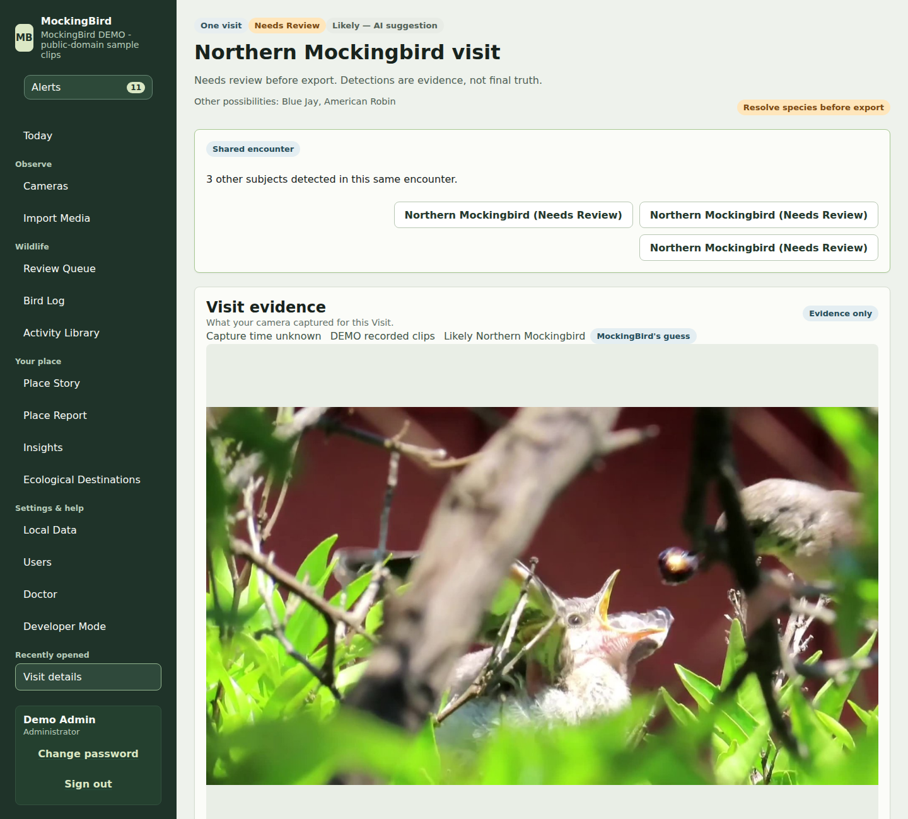
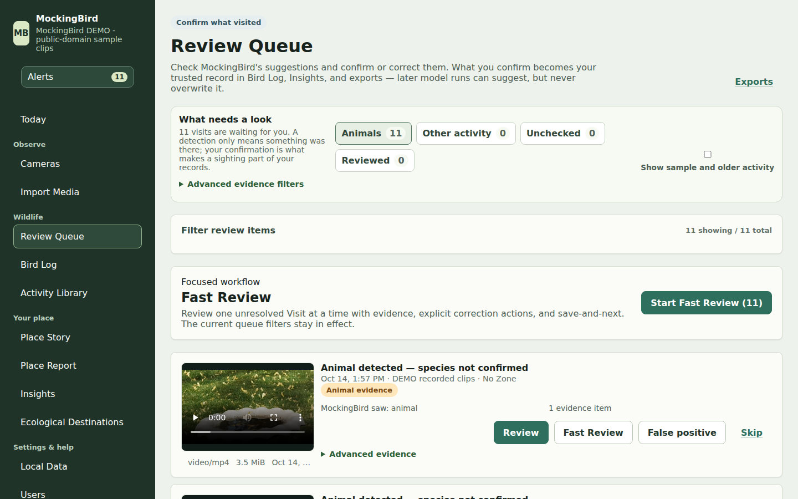
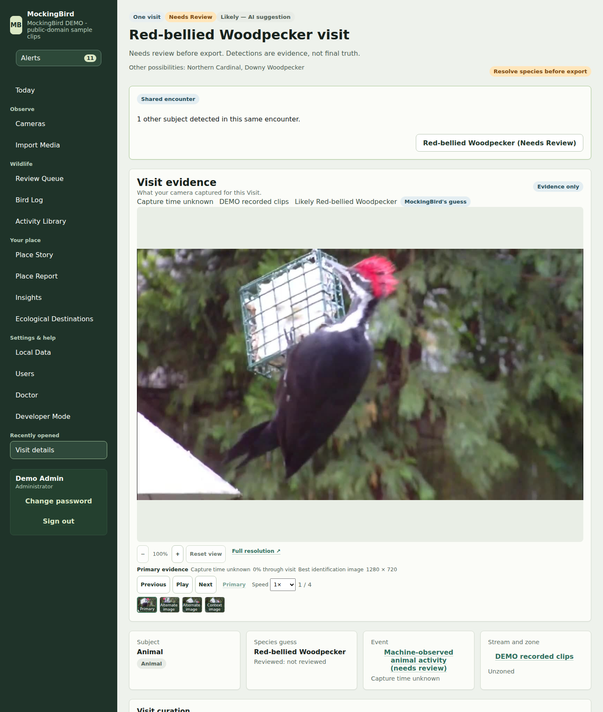
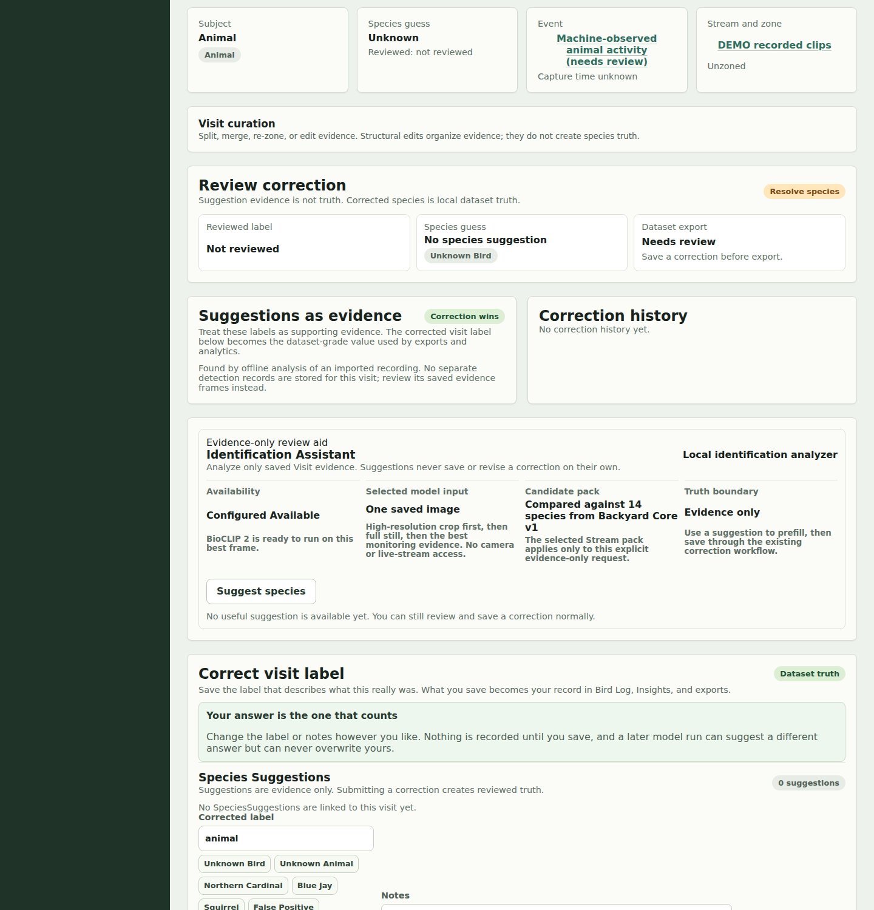
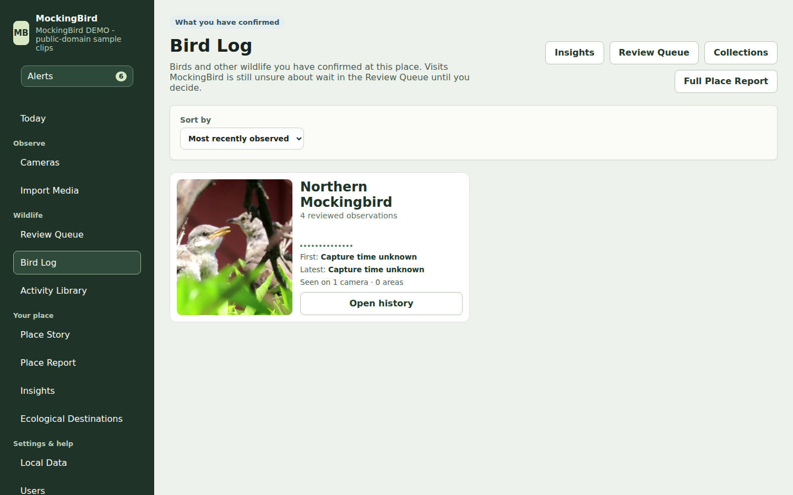
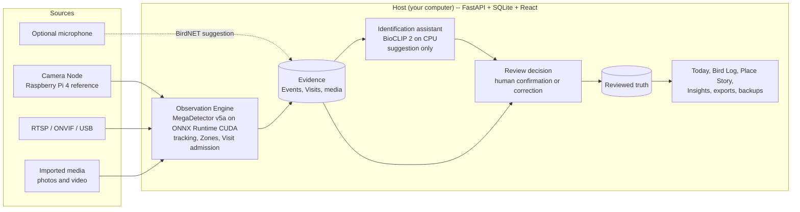

# MockingBird

**A local-first nature observatory that turns camera footage into a record you can trust.**

MockingBird watches the outdoor cameras you choose, notices candidate wildlife
visits, and shows you the best evidence with a *labeled suggestion* of what it
thinks the animal is. **You** confirm or correct it. Only that human decision
becomes the record behind the Bird Log, analytics, and exports. Bird-first, but
built for wildlife in general. It runs on your own computer: no account, no
cloud service, no telemetry.

*A real Visit from the bundled demo (public-domain footage, run through the real
detector and species model). The suggestion is labeled evidence, not truth.*

> **Not surveillance software.** MockingBird is for nature observation. It is
> not an NVR, a security-alert system, or a person-tracking tool, and it keeps
> no continuous recording archive. See [Product doctrine](docs/product-doctrine.md).

**Observe → Discover → Understand → Confirm → Remember → Improve**

| | |
|---|---|
| **Observe** | Connect an outdoor camera (or import recorded media), draw Zones that matter, and start observing. |
| **Discover** | MockingBird notices candidate animal Visits and shows the best evidence. |
| **Understand** | Today, Place Story, Bird Log, and Zone/hour patterns build context over time. |
| **Confirm** | *You* confirm or correct what a Visit is. Model output stays a labeled **suggestion** until you do. |
| **Remember** | Reviewed history is local, durable, backed up, and exportable. |
| **Improve** | Your corrections are the dataset-grade truth that analytics, exports, and future models rely on. |

## Try it without a bird

You don't need a live camera. [`scripts/prepare_demo_instance.py`](scripts/prepare_demo_instance.py)
feeds three **public-domain (CC0) recorded clips** from Wikimedia Commons through
the *unmodified* production path -- recorded-video import, the real MegaDetector
v5a detector, tracking, Visit admission, and the real BioCLIP 2 identification
assistant -- into a disposable, conspicuously labelled **DEMO** instance. Nothing
is simulated and nothing is pre-confirmed: the demo deliberately includes a
correct suggestion, a *confidently wrong* one, and an abstention, so you can see
why a human stays in the loop.

Step-by-step: **[Portfolio demo walkthrough](docs/portfolio-demo-walkthrough.md)**.

| Review: judge the evidence | A suggestion that is wrong | An honest "I'm not sure" |
|---|---|---|
|  |  |  |

After you confirm, the Bird Log and Today are built **only** from what you
decided:

More screenshots (first-run setup, queue after review) are in
[`docs/assets/screenshots/`](docs/assets/screenshots/). They were captured from
the demo instance described in the walkthrough; no private data appears in them.

## What you can trust

- **Suggestions are provisional.** Detector output and species guesses
  (MegaDetector v5a, BioCLIP 2, optional BirdNET) are evidence. Only a human
  confirmation or correction becomes reviewed truth, and Bird Log, analytics,
  and reviewed-only exports derive only from that truth. "Unknown" is a valid
  answer, and the product abstains when candidates are too close to call.
- **Local first.** Detection and species suggestion run on your computer. Data
  stays on disk you control. The cloud is optional and never required; see
  [Privacy & security](docs/privacy-and-security.md).
- **Honest about limits.** If your hardware can't run live detection, or a
  model isn't available, MockingBird says so instead of quietly degrading.
- **Hardware-agnostic by design.** A Raspberry Pi 4 is the *validated
  reference* Camera Node, not the product's identity. Network (RTSP/ONVIF),
  USB, still-image, and imported media are all first-class sources.

## How it works

The one rule the architecture is built around: **model output flows into
evidence; only an explicit human review decision flows into truth.** A single
function, `review_provenance.is_authority_eligible`, decides truth eligibility,
so no analytics, export, or UI path can quietly treat a model guess as fact.
Design detail: [Architecture](docs/architecture.md), [Runtime map](docs/runtime-map.md),
[Glossary](docs/glossary.md).

### Technology

| Layer | Choice | Why |
|---|---|---|
| Host API | Python 3.11+, FastAPI, Pydantic, SQLAlchemy | typed contracts end to end; one process, no services to run |
| Storage | SQLite (schema version 62, forward migrations, verified backups) | local-first, zero-admin, inspectable |
| UI | React 19, TypeScript, Vite | single-page app served by the Host itself |
| Detection | MegaDetector v5a exported to ONNX, ONNX Runtime GPU (CUDA) | a wildlife-trained detector; evidence only |
| Species suggestion | BioCLIP 2 via OpenCLIP, CPU, closed candidate list | ranked, uncalibrated suggestions; abstains when uncertain |
| Acoustic (optional) | BirdNET, CPU, never bundled | suggestions only; model license is non-commercial |
| Camera Node | small Python service on a Raspberry Pi, systemd-supervised | replaceable capture/transport edge; not the system of record |
| Verification | pytest (backend), Playwright (browser), a perception replay harness | see [Engineering quality](#engineering-quality) |

## What 1.0 supports

The first public release is **1.0**. Its supported scope is stated in one place:
**[Support & compatibility matrix](docs/support-matrix.md)**. In short:

- **Host:** native **Windows 10 x64** is the supported, hardware-validated Host
  (Windows 11 expected, not separately validated), as an unpack-and-run ZIP
  (not an installer, not code-signed).
- **Live wildlife detection needs a supported NVIDIA GPU.** Without one,
  review, Bird Log, import, exports, and backup still work.
- **Cameras:** MockingBird Camera Node (reference: Raspberry Pi 4), RTSP/ONVIF
  network cameras, local USB, still-image URLs, and import-only media. Legacy
  local cameras are limited to two armed Streams at a time; Camera Node is not.
- **One observatory / one Place**, multiple cameras. No multi-site, fleet
  management, native mobile app, background push, or MockingBird cloud relay.
- **Linux / macOS** are source-checkout only -- there is no packaged Linux or
  macOS Host in 1.0.
- **Optional bird-sound identification (BirdNET)** is never bundled (its model
  weights are non-commercial licensed) and has no supported add-on route for the
  Windows ZIP.

## Known limitations

Stated plainly, because a trustworthy record starts with honest boundaries:

- **Species identification is a closed-set suggestion, not an authority.** The
  bundled candidate list is a small regional backyard set (14 species). A bird
  outside it can be named *confidently and wrongly* -- the demo shows exactly
  this (a pileated woodpecker suggested as a red-bellied woodpecker). Confirmed
  species outside the bundled taxonomy are saved as local labels but do not yet
  appear in the Bird Log. No accuracy figure is claimed.
- **Multi-subject handling over-splits some encounters.** One woodpecker in the
  demo clip becomes two sibling Visits; review lets you act on each.
- **Recorded clips have no known capture time.** Visits from imported video say
  "Capture time unknown" and are kept out of time-windowed Today/Place Story
  analytics by design (the Bird Log still lists them).
- **Live detection is NVIDIA-GPU only** and the validated Host is Windows 10.
  Real-world field validation was performed on one Raspberry Pi 4 Camera Node
  and one desktop RTX 4060 Ti; broader hardware is unvalidated.
- **Not published yet.** No public release artifact, tag, or version 1.0 bump
  exists; see [Status](#status).

## Engineering quality

- **Tests:** about 350 backend test modules and 50 Playwright browser specs. The
  last recorded full runs (in [release-execution-state.md](docs/release-execution-state.md))
  are 6,278 backend tests passing and 203 browser tests passing, at schema 62.
  They were not re-run in full for the portfolio pass; the changes made here
  were verified with focused runs (see the walkthrough).
- **Validation tiers and a test-isolation contract** keep an automated test from
  ever touching a real database
  ([development-workflow.md](docs/development-workflow.md),
  [test-repository-isolation-contract.md](docs/test-repository-isolation-contract.md)).
- **A perception replay harness** re-runs recorded footage through the real
  admission stack in a disposable database, so a perception fix does not have to
  wait for another real bird
  ([perception-replay-regression-harness-contract.md](docs/perception-replay-regression-harness-contract.md)).
- **Design contracts** under [`docs/`](docs/) record the decisions and their
  evidence (hundreds of documents; start at [Architecture](docs/architecture.md)).

## Get started

- **Install and use MockingBird (Windows):** [Using MockingBird](docs/using-mockingbird.md)
  -- download, verify, unpack, first-run setup, add a camera, observe, review,
  back up, update.
- **Try the demo:** [Portfolio demo walkthrough](docs/portfolio-demo-walkthrough.md).
- **Add a Camera Node** (Raspberry Pi or similar): [Camera Node install guide](docs/camera-node-install-guide.md).
- **Something wrong?** [Troubleshooting & support](docs/troubleshooting.md) and
  [SUPPORT.md](SUPPORT.md).
- **Run from source / contribute:** [Developer setup](docs/developer-setup.md)
  and [CONTRIBUTING.md](CONTRIBUTING.md).

## Backup, recovery, and updates

MockingBird keeps your data in its own local data folder (normally
`%LOCALAPPDATA%\MockingBird` on Windows), separate from the application folder.
Verified backups, rollback-safe restore, an automatic pre-upgrade backup, Doctor
health checks, and a redacted support bundle are built in. Start with
[Using MockingBird -- Backup and restore](docs/using-mockingbird.md#backup-and-restore)
and [Troubleshooting](docs/troubleshooting.md).

## Privacy and security

Local Only operation, exactly which optional features contact the network and
when, remote-access assumptions, credential handling, and what Privacy Zones do
and do not guarantee: [Privacy & security](docs/privacy-and-security.md).
Report vulnerabilities privately per [SECURITY.md](SECURITY.md).

## Documentation map

- [docs/using-mockingbird.md](docs/using-mockingbird.md): normal-user guide
- [docs/portfolio-demo-walkthrough.md](docs/portfolio-demo-walkthrough.md): the reproducible demo
- [docs/portfolio/case-study.md](docs/portfolio/case-study.md): engineering case study (source for a portfolio page)
- [docs/support-matrix.md](docs/support-matrix.md): **canonical** 1.0 support and compatibility statement
- [docs/troubleshooting.md](docs/troubleshooting.md): troubleshooting, Doctor, support bundle, how to file an issue
- [docs/privacy-and-security.md](docs/privacy-and-security.md): privacy and security posture
- [docs/camera-node-install-guide.md](docs/camera-node-install-guide.md): Camera Node install
- [THIRD_PARTY_NOTICES.md](THIRD_PARTY_NOTICES.md): bundled and deliberately-not-bundled components and licenses
- [docs/developer-setup.md](docs/developer-setup.md): source checkout, optional runtimes, tests
- [docs/product-doctrine.md](docs/product-doctrine.md): product identity and truth model
- [docs/architecture.md](docs/architecture.md), [docs/runtime-map.md](docs/runtime-map.md), [docs/glossary.md](docs/glossary.md): design
- [docs/roadmap.md](docs/roadmap.md): current priorities
- [docs/owner-release-checklist.md](docs/owner-release-checklist.md): what the owner must do before publishing
- [AGENTS.md](AGENTS.md): working rules and conditional design-document routing for contributors and coding agents

Focused feature contracts remain under `docs/`.

## Status

The repository is a **pre-release** of the first public release (**1.0**),
pending final release hardening. The source tree currently reports version
`0.1.0`; the 1.0 version bump, final artifacts, and release tag are performed
during release hardening and are not yet done. The demo and screenshots show
the current source tree, not a published release.

## License

MockingBird's own source code is licensed under the [MIT License](LICENSE).

This covers MockingBird's own code only. Third-party components MockingBird
redistributes or depends on -- including the bundled MDv5a and BioCLIP-2
model weights, and the optional BirdNET bird-sound identification feature
MockingBird deliberately does **not** bundle -- are licensed under their own
separate terms, not necessarily MIT, and remain governed by those terms.
The demo clips are CC0 recordings fetched on request, never committed or
bundled. See [THIRD_PARTY_NOTICES.md](THIRD_PARTY_NOTICES.md) for the complete
account of what is bundled, what is not, and under what license.
